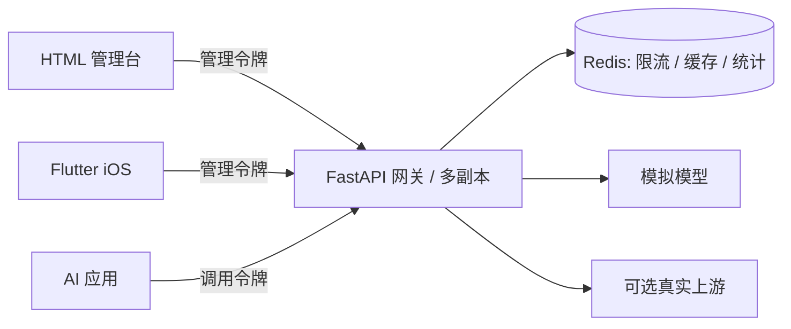

# Harbor AI Gateway

面向个人开发者与小团队的开源、自托管 AI 网关，提供独立 HTML 管理台、Flutter iOS 客户端和 Kubernetes 部署路径。

使用者通过网站、API 和 App 连接自己的模型实例；K8s 学习是维护者的实现路径，不是使用门槛。[产品定位与有限竞品调研](docs/POSITIONING.md) / [开源与审查规则](docs/GOVERNANCE.md)。

**v0.1.1 学习与开发版。默认本地模拟模型，无需云账号或付费 API。** Harbor 是工作名，与 CNCF Harbor 镜像仓库无关联。

## 能力

- OpenAI 风格 `POST /v1/chat/completions`，支持非流式纯文本，模型别名 `gateway-default`。
- 模拟模型，或一个配置好的 OpenAI 兼容上游。
- Redis 原子限流、响应缓存和共享统计，网关可多副本运行。
- HTML 管理台与 Flutter 客户端：状态、试验台、最近记录、连接设置。
- Compose、Kubernetes Deployment / Service / Redis StatefulSet / 探针 / PDB / 可选 HPA。
- 后端和 Flutter 测试，GitHub Actions 检查与容器构建。

网站与 App 连接同一个 API，前台默认每 5 秒自动同步共享记录，可手动暂停或刷新。后台与断开后暂停同步；不会自动发送或重试模型请求。记录标明网站、App、API 来源，限流时显示重试倒计时。



## WSL 启动

在 Ubuntu Bash 中运行：

```bash
cd "/mnt/d/My Project/business_app"
sudo apt-get update
sudo apt-get install -y python3-venv redis-server fonts-noto-cjk
sudo service redis-server start
python3 -m venv ~/.venvs/harbor-gateway
source ~/.venvs/harbor-gateway/bin/activate
pip install -r gateway/requirements-dev.txt
python scripts/init_env.py
uvicorn app.main:create_app --factory --app-dir gateway --host 127.0.0.1 --port 8000 --no-access-log
```

访问 **http://localhost:8000**。在编辑器中打开被 Git 忽略的 `.env`，将 `ADMIN_TOKEN` 的值粘贴到网页连接设置。不要提交、公开或截图分享令牌。

发送相同内容两次，第二次应显示 `CACHE HIT`。默认共享限额每分钟 30 次；超限返回 `429` 和 `Retry-After`。

### Flutter / iOS

另开 WSL 终端：

```bash
source ~/.bashrc
cd "/mnt/d/My Project/business_app"
flutter pub get
flutter run -d chrome --web-port 7357
```

在“连接”填写 `http://localhost:8000` 与同一个 `ADMIN_TOKEN`。App 发送请求后，HTML 网站会在下一次同步时显示来源为 App 的记录。7357 在开发 CORS 白名单；变更时在 `.env` 设置 `CORS_ORIGINS=["http://localhost:新端口"]` 并重启后端。

首次使用按网站上方的三步引导完成连接、发送和多端联动。遇到问题：

| 提示 | 下一步 |
| --- | --- |
| 管理令牌无效 | 使用 `.env` 中的 `ADMIN_TOKEN` 重新连接，不能用 `GATEWAY_TOKEN` |
| 共享调用限额 | 等待按钮倒计时结束，再手动点击；消息不会自动重发 |
| 同步中断 / 上次数据 | 当前统计是旧快照，检查后端、Redis 和网络；恢复后自动同步 |
| 模型上游不可用 | 检查服务端上游配置；提交问题时附上请求 ID，不附令牌或消息正文 |

在网页展开请求 ID 可选中复制；在 App 点击一条记录查看完整详情。来源仅为客户端展示标签，不能当作可信审计身份；升级前的旧记录显示“未标记”。

**iOS 编译、模拟器、签名和上架需要 macOS + Xcode，WSL 无法执行。** 在 Mac 安装 Flutter 后：

```bash
flutter pub get
open -a Simulator
flutter run -d <flutter-devices列出的iOS设备ID>
```

同一台 Mac 的模拟器可连接 `http://localhost:8000`。跨机器或真机使用可达且证书受信任的 HTTPS 服务地址；手机的 localhost 是手机自身。客户端拒绝远程 HTTP 地址，不全局放开 ATS。发布前替换默认 Bundle ID、配置自己的签名团队，并做真机网络测试。

## 配置

| 变量 | 用途 / 默认值 |
| --- | --- |
| `ADMIN_TOKEN` | 管理台/App 令牌，至少 16 字符 |
| `GATEWAY_TOKEN` | `/v1/*` 调用令牌，必须与管理令牌不同 |
| `REDIS_URL` | `redis://localhost:6379/0` |
| `PROVIDER` | `mock` 或 `openai-compatible` |
| `UPSTREAM_BASE_URL` | `https://api.openai.com/v1`，只允许 HTTPS |
| `UPSTREAM_API_KEY` | 仅服务端保存，真实模式必填 |
| `UPSTREAM_MODEL` | 真实上游模型名，真实模式必填 |
| `RATE_LIMIT_PER_MINUTE` | `30`，整个单租户共用 |
| `CACHE_TTL_SECONDS` | `60`；`0` 关闭缓存 |
| `CORS_ORIGINS` | JSON 数组，默认 `["http://localhost:7357"]` |

真实模式产生供应商 API 费用。v0.1 无 Anthropic 原生协议、SSE、工具调用或计费，不是完整 OpenAI API 替代品。模型由服务端选择，客户端使用固定别名。

管理令牌仅存前端会话内存。请求日志只含元数据，不存消息正文；**响应缓存暂存回复文本**，敏感场景请关闭缓存。Redis 示例无认证、高可用，仅用于私有开发网络。

## Compose

在 Docker Desktop 的 Settings → Resources → WSL Integration 启用 Ubuntu，确认 `docker version` 同时显示 Client 和 Server。

```bash
python3 scripts/init_env.py
docker compose up --build -d
docker compose ps
```

网站仍在 http://localhost:8000，端口只绑定本机。Redis 数据卷在 `docker compose down` 后保留。

## 本地 Kubernetes

正式云入口的配置草案见 [AWS EC2 + K3s + HTTPS](deploy/aws/README.md)。对外使用标准 HTTPS 443；当前尚无 AWS 账户，没有创建云资源、域名或实际部署公网网站。请勿将目标 URL 当作已上线地址。

需要 Docker、[kind](https://kind.sigs.k8s.io/docs/user/quick-start/) 与 [kubectl](https://kubernetes.io/docs/tasks/tools/install-kubectl-linux/)，无需云账号。

```bash
kind create cluster --name harbor
docker build -f gateway/Dockerfile -t harbor-gateway:local .
kind load docker-image harbor-gateway:local --name harbor
python3 scripts/init_env.py
kubectl apply -f deploy/k8s/namespace.yaml
kubectl -n harbor create secret generic harbor-auth --from-env-file=.env
kubectl apply -k deploy/k8s
kubectl -n harbor rollout status statefulset/redis --timeout=180s
kubectl -n harbor rollout status deployment/gateway --timeout=180s
kubectl -n harbor port-forward svc/gateway 8000:8000
```

先停止占用 8000 的原生后端。Secret 只需首次创建，更新后需更新 Secret 并重启网关。不要提交 Secret 明文或 base64。

Redis PVC 需要默认 StorageClass，排错时检查 `kubectl get storageclass` 和 `kubectl -n harbor get pvc`。Redis 只有一个副本，网关多副本不等于全系统高可用。

NetworkPolicy 要求支持它的 CNI，kind 默认 kindnet 不执行该策略。这是本地学习配置。公网部署还需受信任的 HTTPS 入口、Redis ACL/TLS、备份、访问控制。

### K8s 实验

1. **多副本**：`kubectl -n harbor scale deployment/gateway --replicas=3`。分别 port-forward 两个 Pod，验证配额和统计相同。一次 Service port-forward 固定一个 Pod，不是逐请求负载均衡。
2. **滚动更新**：以新标签构建和加载镜像，再 `kubectl -n harbor set image deployment/gateway gateway=harbor-gateway:新标签`，观察 `rollout status`，练习 `rollout undo`。
3. **探针**：在实验集群停止 Redis，观察 readiness 失败而 liveness 存活，恢复后继续请求。
4. **HPA**：安装兼容的 [Metrics Server](https://kubernetes-sigs.github.io/metrics-server/)，确认 `kubectl top pods -n harbor` 有数据，再 `kubectl apply -f deploy/k8s/hpa.yaml`。模拟回复很轻，不能据此宣称验证了自动扩容；CPU 指标不一定随 I/O 请求量上涨。

`/metrics` 提供整个单租户的聚合 Prometheus 计数，需管理令牌。只抓 Service 一个目标，不要按 Pod 抓后求和，以免重复计数。

## 验证与贡献

```bash
source ~/.venvs/harbor-gateway/bin/activate
PYTHONPATH=gateway python -m pytest gateway/tests -q
dart format lib test
flutter analyze
flutter test
flutter build web
kubectl kustomize deploy/k8s
```

网页交互验收使用隔离的 mock 服务，不读取本地令牌、不调用付费模型：

```bash
pip install -r gateway/requirements-ui.txt
PYTHONPATH=gateway CHROME_EXECUTABLE=/usr/bin/google-chrome python scripts/test_site.py
```

没有现成 Chrome 时，先执行 `python -m playwright install --with-deps chromium`，再去掉 `CHROME_EXECUTABLE` 运行脚本。

测试覆盖凭证隔离、跨副本状态、并发限流、Redis 故障关闭、上游转发和错误脱敏。真实供应商通过 HTTP mock 验证，不调用付费模型。Flutter 测试检查凭证传递与共享指标展示。

CI 对 push/PR 执行检查、网页浏览器验收、容器构建和 K8s schema 校验。另有手动触发的 macOS iOS 无签名编译 workflow，不替代真机验证。暂不自动发布 GHCR 或部署，先跑稳 CI，再加入明确的发布流程。

```text
lib/               Flutter 管理客户端
site/              HTML / CSS / JavaScript 管理台
gateway/app/       FastAPI 网关
gateway/tests/     后端测试
deploy/k8s/        K8s 与可选 HPA
scripts/           环境工具
docs/ROADMAP.md    发展目标和阶段验收
```

参见 [产品决策与优先级](docs/PRODUCT.md)、[路线图](docs/ROADMAP.md)、[验证记录与限制](docs/VALIDATION.md)、[贡献指南](CONTRIBUTING.md) 和 [安全说明](SECURITY.md)。许可：[MIT](LICENSE)。
