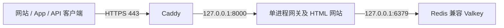

# 在现有小型 EC2 上验证公开访问

这是低流量、单租户预览部署，不是 Kubernetes 部署或多用户 SaaS。适用于已有的 Amazon Linux 2023 x86_64 实例，不会创建或调整计费资源。系统服务会随主机启动，并在进程失败后重启。



## 部署

1. 确认实例的**当前**公网 IP。安全组只向操作者当前出口 IP 放行 SSH 22，向公众放行 TCP 80、443。不要开放 8000、6379 或 Kubernetes API。
2. 将自有域名解析到该 IP；没有域名时可临时使用 `modeljetty.<IP用短横线连接>.sslip.io`。从公网确认 DNS 解析正确。
3. 将审查通过的仓库克隆到服务器，在该提交执行：

```bash
sudo bash deploy/vm/install.sh modeljetty.YOUR-IP.sslip.io REVIEWED_40_CHARACTER_COMMIT
```

默认是私有管理台接入。要在纯模拟实例开放免费访客体验，在命令末尾加 `public-demo`：

```bash
sudo bash deploy/vm/install.sh modeljetty.YOUR-IP.sslip.io REVIEWED_40_CHARACTER_COMMIT public-demo
```

访客点击“免费体验”，不需要任何管理令牌。演示使用独立的随机会话和 Redis 命名空间，记录只属于当前浏览器，15 分钟后过期，不缓存或记录消息正文。每位访客每分钟最多 5 次模拟请求，全部访客合计每分钟 30 次。创建会话也有每 IP 及全局上限。该模式拒绝真实模型供应商配置，演示代码也不持有上游客户端，不能用于付费推理。退出体验会清理会话及其记录；重新部署时不传 `public-demo` 即关闭入口。

安装器固定检出传入的提交，使用一个非 root 网关进程、回环地址上的 Valkey，以及自动签发和续期证书的 Caddy。Caddy 二进制固定版本并校验上游 SHA512 清单。首次安装生成独立的服务器凭据，后续执行保留凭据及数据。默认模拟模型、每分钟共享限额 30 次、关闭响应缓存，不使用付费模型。

网站能被所有人打开，管理台连接仍需要服务器的 `ADMIN_TOKEN`；API 调用使用不同的 `GATEWAY_TOKEN`。凭据在 `/etc/modeljetty/gateway.env`，仅 root 可读，不能提交到 Git 或放进网页。可信测试者共享同一个私有实例及请求统计，当前没有账号注册或完整多租户功能；可选的访客演示与私有管理台数据隔离。不要把管理令牌发布到公共页面。

## 验收与运维

先验证 HTTPS 证书可信，HTTP 自动跳转到 HTTPS。未携带凭据请求 `/api/overview` 应返回 401。然后在网站连接设置输入服务器的管理令牌，发送模拟请求；另一个浏览器或 App 连接同一实例，应看到请求记录同步。

```bash
sudo systemctl status modeljetty-{redis,gateway,web}
curl --fail http://127.0.0.1:8000/health/ready
sudo journalctl -u modeljetty-gateway -u modeljetty-web --since '10 minutes ago'
free -m
df -h /
```

三个服务的内存上限分别为 192、256、128 MB，单实例容量有限。Valkey AOF 在 `/var/lib/modeljetty/redis`；应另行备份该目录与 root-only 配置。日志不会记录请求体或 Authorization。没有负载均衡或高可用；更新服务有短暂中断。回滚时重新执行安装器，传入此前验证的提交，凭据和数据保留。

临时域名依赖第三方 DNS，普通 EC2 公网 IP 在停止再启动后可能变化。不要把这个地址当作长期服务承诺；后续迁移自有域名及资源充足的 K8s。安装器不会修改现有 K8s 文件或验证其运行状态。
